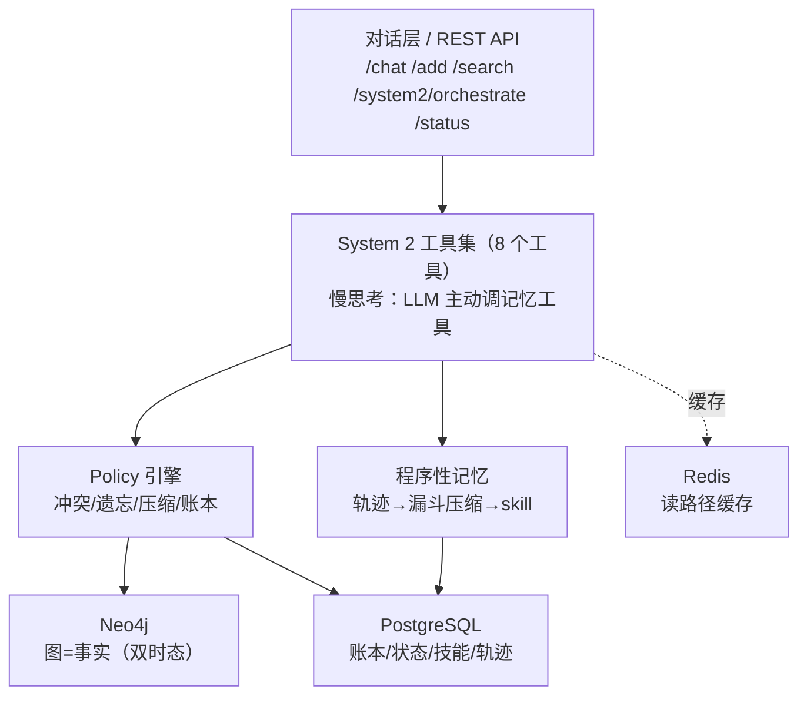

# GraphMemory — 双时态 AI 记忆系统

> 一个让 AI 从「查字典回消息的工具」变成「能积累经验、学习技能、记住历史的伙伴」的记忆系统。

基于 [Graphiti](https://github.com/getzep/graphiti)（时序知识图谱）+ 自建扩展，落地「五命题 + 两坑」记忆架构。

> ⚡ **日常使用只需要一个球**：桌面上的绿色悬浮球 —— 单击开关，颜色即状态。
> 绿=运行中 / 黄=半死 / 灰=已停止 / 蓝=处理中。详见 [5.8 悬浮球详解](#58-桌面悬浮球一键开关详解)。

---

## 目录

1. [思路：为什么这样设计](#一思路为什么这样设计)
2. [系统架构](#二系统架构)
3. [开发阶段（详细）](#三开发阶段详细)
4. [核心概念详解](#四核心概念详解)
5. [操作步骤（含悬浮球）](#五操作步骤完善)
6. [数据表结构](#六数据表结构)
7. [测试](#七测试)
8. [遗留与展望](#八遗留与展望)

---

# 一、思路：为什么这样设计

## 1.1 核心目标

普通的 AI 对话是「无状态」的：每次对话结束，它就忘了你。GraphMemory 要解决的是——

- **记住事实**：你说过"我叫张三、在 A 公司工作"，它以后能想起来。
- **记住时间**：知道"张三 2024 年在 A 公司、2024 年 6 月离职了"，能回答"过去"和"现在"两个问题。
- **记住怎么做**：踩过一次坑、走通一次流程，下次直接复用，不重复试错。
- **主动想起**：该关心的时侯关心，该提醒的时侯提醒。

## 1.2 理论基础：五命题 + 两坑

这套架构源自 Companion AI v2 项目的独创记忆设计，是整个系统的「魂」：

```
命题一：记忆 = 影响决策的外部状态（不是存储区）
命题二：Memory 最小可用闭包 = Ledger + Views + Policy
命题三：Agentic Memory = System 2 慢思考（LLM 主动调用记忆工具）
坑一：  双时态（Valid Time + Transaction Time）— 时间保命机制
坑二：  程序性记忆（交互轨迹 → skill 压缩）— 效率保命机制
```

每一句都对应了代码里的一个具体模块，见[核心概念](#四核心概念详解)。

## 1.3 为什么不用现成方案

| 方案 | 双时态 | Policy | System 2 | 程序记忆 | 结论 |
|------|--------|--------|----------|----------|------|
| FastGPT | ❌ | ❌ | ❌ | ❌ | 只做 RAG，不够 |
| Mem0 (64k⭐) | ⚠️ 时间感知 | ❌ | ❌ | ❌ | 最火但最浅 |
| Letta/MemGPT (24k⭐) | ⚠️ 部分 | ⚠️ Sleeptime | ✅ 原生 | ❌ | System 2 强，双时态弱 |
| **Graphiti (30k⭐)** | ✅ 原生 | ❌ | ⚠️ MCP | ❌ | **双时态最强，作基础层** |
| **本方案** | ✅ 强制切片 | ✅ 完整 | ✅ 工具化 | ✅ 轨迹压缩 | **完整覆盖五命题+两坑** |

**决策**：Graphiti 解决最难的「双时态 + 图谱」部分，我们在它上面自建 Policy（策略）和程序性记忆。

## 1.4 核心设计理念

1. **记忆是状态，不是仓库**：三个数据库只是「原材料仓库」，真正"影响决策"的是上面的 Policy + System 2 层。
2. **不删除，只标记**：遗忘 = 改变视图（archived/superseded/demoted），原始数据永远保留。这是双时态保命的核心。
3. **分层解耦**：写入、检索、策略、压缩、工具，各自独立，通过依赖注入组装。
4. **可溯源**：每条记忆都带「哪个 agent 在哪个会话用哪个模型记的」。

---

# 二、系统架构

## 2.1 总体架构

```
┌─────────────────────────────────────────────────────┐
│                    对话层 / API                        │
│         /chat  /add  /search  /system2/orchestrate    │
└─────────────────────────┬───────────────────────────┘
                          │
┌─────────────────────────▼───────────────────────────┐
│              System 2 工具集（8 个工具）                │
│   慢思考：LLM 主动调用记忆工具，而非被动查字典            │
└──────────┬──────────────────────┬────────────────────┘
           │                      │
┌──────────▼─────────┐   ┌────────▼───────────────────┐
│   Policy 引擎        │   │   程序性记忆                 │
│  冲突/遗忘/压缩/账本  │   │   轨迹→漏斗压缩→skill         │
└──────────┬─────────┘   └────────┬───────────────────┘
           │                      │
┌──────────▼──────────────────────▼───────────────────┐
│                存储层（三数据库）                       │
│  Neo4j（图=事实） PostgreSQL（账本/状态/技能） Redis（缓存）│
└──────────────────────────────────────────────────────┘
```

**图片版架构图**（`architecture.png`）：


**Mermaid 版**（GitHub / Typora / VS Code 可直接渲染）：



## 2.2 三大数据库分工

| 数据库 | 存什么 | 为什么是它 |
|---|---|---|
| **Neo4j**（图） | 实体-关系-实体的事实网 | 事实之间天然是「网」，图表达最自然；Graphiti 原生支持双时态 |
| **PostgreSQL**（关系） | 账本(ledger)、状态(fact_state)、技能(skills)、轨迹、审计(policy_events)、agent/session | 流水账、计数器、规则用表格最合适 |
| **Redis**（缓存） | 读路径缓存（用户档案、近期上下文） | 提速，避免每次都打数据库 |

## 2.3 目录结构

```
D:\GraphMemory\
├── README.md                  ← 本文档
├── API.md                     ← 接口请求/响应示例
├── architecture.png           ← 架构图（图片版）
├── ARCHITECTURE.md            ← 架构设计（原始稿）
├── REPORT.md                  ← 进度报告
├── docker-compose.yml         ← 三容器编排
├── pyproject.toml             ← Python 项目配置
├── .env / .env.example        ← 环境变量（含 API Key）
├── start.ps1 / stop.ps1       ← 一键启停（脚本层）
├── autostart.vbs              ← 开机自启（服务层）
├── ball.py                    ← 桌面悬浮球（一键开关控制台，pythonw 运行）★
├── ball.log / ball-pos.json   ← 球的操作日志 / 位置记忆
├── graphmemory.ico            ← 球体图标（快捷方式用）
├── tray.py                    ← 托盘版备选（早期版本，默认不用）
├── demo.py / chat.py          ← 演示 / 交互聊天
├── scripts/init_db.sql        ← 建表脚本
├── src/graphmemory/
│   ├── main.py                ← FastAPI 入口 + 装配
│   ├── config.py              ← 配置
│   ├── router.py              ← 多模型路由
│   ├── cache.py               ← Redis 缓存
│   ├── chat.py                ← 对话服务
│   ├── core/graphiti_client.py← Graphiti 封装（双时态检索）
│   ├── models/memory.py       ← 数据模型
│   ├── policy/                ← Policy 引擎（规则/仓储/引擎）
│   ├── procedural/            ← 程序性记忆（记录/压缩/引擎/仓储）
│   ├── system2/               ← System 2 工具集 + 编排
│   ├── agents/                ← 多 agent 归属
│   └── api/                   ← 路由 + schema
└── tests/                     ← 44 个测试
```

---

# 三、开发阶段（详细）

## Phase 1：基础设施 + 代码骨架 + 联通

**目标**：把三数据库跑起来，写出可运行的骨架，验证端到端写入/检索。

- 安装 WSL2、Docker Desktop、Neo4j 5.26、PostgreSQL 16+pgvector、Redis 7
- 写 `docker-compose.yml` 编排三容器
- 写 `pyproject.toml`、`.env`、`init_db.sql`（建表）
- 写 `config.py`（Pydantic Settings）、`main.py`（FastAPI 入口）、`models/memory.py`（Fact/Entity/Episode/Skill/TimeSlice 等模型）
- 写 `core/graphiti_client.py`：封装 Graphiti 的读写，实现「强制时间切片检索」
- 写 3 个核心 API：`/add`、`/search`、`/timeline`

**关键决策/踩坑**：
- graphiti-core 装的是 0.30.1（代码按 0.11 写），需核对 API 签名差异
- 智谱 GLM 是 OpenAI 兼容协议，需把 `base_url` 传入 LLM 和 Embedder
- graphiti 0.30.1 结构化抽取走 OpenAI Responses API，智谱不支持 → 换 `OpenAIGenericClient`（chat/completions + json_object）
- numpy MINGW 实验版在 Python 3.13 上段错误 → 升级 numpy 2.x

## Phase 2：Policy 引擎（命题二的 Policy 层）

**目标**：实现「何时写、何时遗忘、何时压缩、冲突裁决」。

- 新增 `fact_state` 表（Views 层：置信度/访问次数/降级/归档/被覆盖）
- `policy/rules.py`：规则阈值（PolicyConfig）+ 事实类型启发式分类
- `policy/repository.py`：asyncpg 操作 fact_state + policy_events + ledger
- `policy/engine.py`：三类触发
  - `on_fact_added`：冲突裁决（新覆盖旧 / 多次确认提升置信度 / 矛盾裁决）+ 账本记录
  - `filter_and_record`：检索期遗忘过滤 + 访问计数
  - `scheduled_maintenance`：短期降级 / 长期归档 / 去重合并 / 健康报告
- 接入写入流（add 后触发）与检索流（search 前过滤）
- API：`/maintenance`、`/health-report`

## Phase 3：程序性记忆（坑二）

**目标**：交互轨迹 → skill 压缩，避免重复试错。

- `procedural/recorder.py`：TraceRecorder 上下文管理器，任务中逐步记录
- `procedural/compressor.py`：**漏斗压缩算法**（过滤噪音 → 提取关键路径 → 参数化模板，LLM 可选）
- `procedural/engine.py`：固化、执行反馈、成功率追踪（增量平均）、低成功率自动降级、查找适用技能
- API：`/traces`、`/skills/compress`、`/skills`、`/skills/applicable`、`/skills/{id}/execution`、`/skills/maintenance`

## Phase 4：System 2 工具集（命题三）

**目标**：给 LLM「机器臂」，让它主动查询记忆，触发慢思考。

- `system2/tools.py`：8 个记忆工具（get_user_profile / get_recent_context / search_facts / get_emotion_trend / get_relationship_graph / get_skill / record_fact / timeline_query）+ OpenAI function-calling schema
- `system2/orchestrator.py`：System 1（快速）vs System 2（慢思考）决策路由 + 工具选择（LLM 可选，启发式兜底）
- API：`/tools`、`/tools/{name}`、`/system2/orchestrate`

## Phase 5：集成与优化

**目标**：多模型路由、监控、缓存、对话集成。

- `router.py`：ModelRouter（task_type→模型 + preference + 失败回退）
- `cache.py`：Redis 缓存（接入 get_user_profile / get_recent_context）
- `/status`：组件连通性（Neo4j/Postgres/Redis）+ 记忆统计
- `chat.py` + `/chat`：完整对话循环（System 2 编排 → 记忆上下文 → 选模型 → LLM 回复）
- 日志轮转（RotatingFileHandler）

## 附加：多 agent 归属模块

**目标**：回答「哪个记忆属于哪个 agent」「换 agent / 换模型怎么办」。

- `agents` 表（房间/花名册）+ `sessions` 表（箱子/会话分类）
- 6 张记忆表补 `agent_id`/`session_id`/`model` 三列（含账本、审计）
- API：注册 agent、开箱、换模型（继承+标记）、关箱、列 agent/箱
- 模型：`Agent`/`Session` + Fact/InteractionTrace/Skill 补归属字段

## 附加：优化与加固轮次

- 修 bug：.gitignore、compress 404、timeline 参数
- 死表 ledger 激活（写 add_fact/supersede 账本）
- 死依赖 Redis 转正（缓存）
- config 默认值对齐智谱
- 代码质量：私有方法改公有、精度、列表分页
- API Key 可选鉴权（X-API-Key，默认关闭）
- LLM 客户端缓存、共享连接池（4 池 → 1 池）

---

# 四、核心概念详解

## 4.1 双时态（坑一）

每条记忆同时带两个时间：

```
{ "张三是A公司总监",
  valid_from:    2024-01,   ← 现实中什么时候为真（Valid Time）
  valid_until:   2024-06,   ← 现实中什么时候失效
  created_at:    2024-03 }  ← 系统什么时候知道的（Transaction Time）
```

- 查当前事实：`valid_until IS NULL`
- 查历史事实：时间切片 `[valid_from, valid_until)`
- 查变迁历史：不带过滤，返回完整时间线

**价值**：能回答「过去某时他是什么职位」，而不是只能回答「现在」。

## 4.2 Policy 引擎（命题二）

Memory = **Ledger + Views + Policy**：

| 概念 | 落地 | 作用 |
|---|---|---|
| Ledger（账本） | `ledger` 表 | 只追加的原始事件，不可改 |
| Views（视图） | `fact_state` 表 | 置信度、访问次数、降级、归档、被覆盖的「当前状态」 |
| Policy（策略） | `policy/` 包 | 规则：何时冲突、何时遗忘、何时压缩 |

**三条核心规则**：
- 冲突裁决：新事实覆盖旧事实（superseded）；多次确认提升置信度；双方高置信标记需复核
- 遗忘机制：短期（30 天未访问 → 降级）、长期（180 天+低置信 → 归档）、核心身份/偏好永不遗忘
- 压缩机制：重复事实合并、对话摘要压缩

## 4.3 程序性记忆（坑二）

**漏斗压缩**：一条完整轨迹 → 一个可复用技能。

```
完整轨迹（含失败、重复、噪音）
  → 过滤噪音（删失败步骤、连续重复）
  → 提取关键路径（导致成功的核心步骤）
  → 参数化模板（具体值 → {{占位符}}）
  → Skill（成功率 1.0，来源轨迹可溯源）
```

**成功率追踪**：每次执行按增量平均更新成功率，低于阈值自动降级（disabled）。

## 4.4 System 2（命题三）

**System 1 vs System 2**：
- 简单问候 → System 1 直接回复
- 需要上下文 → System 2 主动调工具查记忆，再综合判断

**8 个工具**复用了前三层：图谱（search_facts/record_fact/timeline_query）、Policy 视图（get_user_profile/get_recent_context/get_emotion_trend/get_relationship_graph）、程序性记忆（get_skill）。

## 4.5 多 agent 归属

三级结构：

```
房间（agent）→ 箱子（session）→ 物品（记忆条目）
```

- 换 agent = 登记新房间（各记各的）
- 换模型 = 箱子不变，只标记 `model`（继承+溯源）
- 每条记忆带 `agent_id + session_id + model`

---

# 五、操作步骤（完善）

> **⚡ 工作站日常（速查）**
> - **开机后**：球自动出现（若已勾选自启）→ 看一眼颜色就知道记忆库状态
> - **要用记忆库**：🟢 绿色直接用；🟡⚪ 点一下球，等它变绿（1~2 分钟）
> - **收工**：可以点球停止（省 ~2GB 内存），也可以不管它（数据始终保留，随时可用）
> - **出问题**：先看球的颜色 → 再查 `ball.log`（球的操作）和 `autostart.log`（服务启动过程）
>
> 📍 **地址速查**：API 健康检查 `http://127.0.0.1:8000/api/v1/memory/health` · Swagger `http://127.0.0.1:8000/docs` · Neo4j 浏览器 `http://127.0.0.1:7474`
> 🗄 **数据安全**：数据在 Docker 卷里；`docker compose down` **不删数据**，只有 `down -v` 才删（危险）

## 5.1 环境要求

- Windows 11 + Docker Desktop（4.89+）
- Python 3.13
- 智谱 GLM API Key（OpenAI 兼容）

## 5.2 首次配置

1. 编辑 `D:\GraphMemory\.env`，填入你的 API Key：
   ```
   OPENAI_API_KEY=你的智谱Key
   ```
2. 安装依赖（在 `D:\GraphMemory` 目录）：
   ```
   pip install -e .
   ```
3. 初始化数据库（建表，只需一次）：
   ```
   docker compose up -d
   Get-Content scripts/init_db.sql | docker exec -i graphmemory-postgres psql -U graphmemory -d graphmemory
   ```

## 5.3 启动 / 停止（首选：桌面悬浮球）

**日常就用悬浮球**：桌面上的球 —— **单击 = 开 / 关**，**颜色 = 状态**。

| 方式 | 适合场景 |
|---|---|
| ⚡ **点悬浮球** | 日常首选：一眼看状态 + 一键开关（见 [5.8](#58-桌面悬浮球一键开关详解)） |
| 双击桌面「GraphMemory 记忆库」 | 球被关掉后，重新召唤它 |
| 双击 `start.ps1` / `stop.ps1` | 命令行习惯 / 球不在时 |
| 球右键菜单 →「⚙ 开机自动启动」 | 让球开机常驻，随时可用 |

**手动命令**：
- 启动：`powershell -ExecutionPolicy Bypass -File D:\GraphMemory\start.ps1`
- 停止：`powershell -ExecutionPolicy Bypass -File D:\GraphMemory\stop.ps1`（数据不丢）

**验证是否在跑**：球是绿色，或浏览器打开 `http://127.0.0.1:8000/api/v1/memory/health`，看到 `{"status":"ok"}`。

> 📌 Docker 冷启动可达 2 分钟，属正常——球会蓝色脉冲直到就绪，不用盯着等。

## 5.4 最快体验

**交互聊天**（会记住你）：

```
cd D:\GraphMemory
python chat.py
```

然后打字聊天即可，输入 `quit` 退出。

**自动演示**（一次性跑通全流程）：

```
python demo.py
```

## 5.5 完整 API 清单

所有接口前缀：`http://127.0.0.1:8000/api/v1/memory`

> 📖 **每个接口的详细请求/响应示例见 [API.md](API.md)**

| 方法 | 路径 | 用途 |
|---|---|---|
| POST | `/add` | 写入记忆（自动抽取事实+实体+关系，双时态标注） |
| POST | `/search` | 时间切片检索事实 |
| POST | `/timeline` | 查询实体完整时间线 |
| GET | `/health` | 健康检查 |
| POST | `/chat` | 带记忆的对话（System 2 编排 + LLM 回复） |
| GET | `/status` | 组件健康 + 记忆统计 |
| POST | `/maintenance` | 执行一次 Policy 维护（遗忘/去重） |
| GET | `/health-report` | 记忆健康报告 |
| POST | `/traces` | 记录交互轨迹 |
| POST | `/skills/compress` | 轨迹 → 漏斗压缩成技能 |
| GET | `/skills` | 列出技能 |
| GET | `/skills/applicable` | 查适用技能 |
| POST | `/skills/{id}/execution` | 回报执行结果（更新成功率） |
| POST | `/skills/maintenance` | 低成功率技能降级 |
| GET | `/tools` | 8 个工具 schema |
| POST | `/tools/{name}` | 执行单个工具 |
| POST | `/system2/orchestrate` | System 2 编排 |
| POST | `/agents` | 注册 agent（房间） |
| GET | `/agents` | 列出 agent |
| GET | `/agents/{id}` | 查 agent |
| POST | `/agents/{id}/sessions` | 开会话箱子 |
| GET | `/agents/{id}/sessions` | 列会话 |
| POST | `/sessions/{id}/model` | 换大模型（继承+标记） |
| POST | `/sessions/{id}/close` | 关闭会话 |

## 5.6 典型使用流程（多 agent + 换模型）

```
1. 注册 agent：  POST /agents {"agent_id":"助手A","name":"助手A"}
2. 开箱：       POST /agents/助手A/sessions {"title":"闲聊","model":"glm-4-plus"}
3. 存记忆：     POST /add {"content":"我叫小明，喜欢打游戏","agent_id":"助手A"}
4. 对话：       POST /chat {"message":"我叫什么","user_id":"助手A"}
5. 换模型：     POST /sessions/{id}/model {"model":"deepseek-chat"}
```

## 5.7 常见问题排查

| 问题 | 排查 |
|---|---|
| health 打不开 | 看 `D:\GraphMemory\autostart.log`（启动日志），或重跑 `start.ps1` |
| 对话没回复 | 智谱额度/限流（429），看 `server.err`；或换模型 |
| 数据没了？ | `docker compose down -v` 会删数据（危险），普通 `down` 不删；数据在 volume 里 |
| 中文乱码 | PowerShell 发中文会乱码，用 `chat.py`/`demo.py`（Python UTF-8）或 Postman |
| 球不见了 | 双击桌面「GraphMemory 记忆库」快捷方式重新召唤 |
| 球是黄色（半死） | 点一下球（完成停止）→ 再点一下（重新启动） |
| 点了球很久没反应 | 看 `ball.log` 最后几行定位卡点（见 [5.8](#58-桌面悬浮球一键开关详解)） |

## 5.8 桌面悬浮球（一键开关）详解

### 设计思路：为什么是"球"

记忆库的开关不该藏在命令行里，但也没有走"托盘图标"或"桌面快捷方式"的老路，原因：

1. **任务栏是自动隐藏的**：本机为了屏幕空间把任务栏设为自动隐藏——托盘图标平时根本看不见。"一键"的前提是"一眼可见"。
2. **快捷方式只能开、不能关**：开关是双向需求；而且双击 .ps1 会闪黑窗，不优雅。
3. **球是最小可用的"控制台"**：
   - **常驻可见**：置顶显示但不抢焦点，不打断你手头的事
   - **颜色即状态**：零文字阅读成本，余光一瞥就知道
   - **可拖动**：不挡工作区，位置自动记忆
   - **与桌面伴侣的视觉语言一致**：它是整体体验的一部分，不是外来弹窗
4. **状态即真相（关键设计）**：球不记录"上次你按了什么"，而是每 3 秒**实测**真实状态（3 个容器在不在 + API 健康检查通不通）。哪怕服务是被外部搞挂的（Docker 崩了、手动跑了脚本），球也会立刻变黄警示——**它显示的是事实，不是意图。**

### 状态语义

| 颜色 | 状态 | 含义 |
|---|---|---|
| 🟢 绿色 | 运行中 | 3 容器 healthy + API 在线（一切正常） |
| 🟡 黄色 | 部分运行（半死） | 容器在但 API 挂了，或反之——常见于异常退出之后 |
| ⚪ 灰色 | 已停止 | 全部停止（数据完整保留） |
| 🔵 蓝色脉冲 | 启动中 / 停止中 | 过程态（约 5 秒 ~ 2 分钟） |

### 交互

| 操作 | 效果 |
|---|---|
| **单击** | 一键开 / 关（黄色半死时：单击先走停止流程，再点即重启） |
| **拖动** | 移到任意位置（自动记忆，下次原位出现） |
| **右键** | 菜单：启停 · 重启 · 🖥 管理台 · API 控制台 · Neo4j 浏览器 · 查看日志 · 开机自动启动 · 退出 |
| **悬停** | 状态气泡（含容器数 + API 状态） |

### 5.9 管理台（网页版 GUI）— P0 上手界面

清爽浅色管理台，随 API 一起启动，**零额外进程、零依赖**（原生 HTML+JS+CSS，离线可用）：

- **打开**：浏览器访问 `http://127.0.0.1:8000/ui/`（悬浮球右键 →「🖥 管理台」）
- **五个 Tab**：总览（组件健康+统计+一键维护）｜记忆（写入/搜索/时间线/事实库，事实带双时态与遗忘状态徽章）｜对话（System 1/2 徽章 + 工具调用 + 记忆上下文可见）｜技能（轨迹→压缩→执行反馈）｜Agents（房间/会话/换模型）
- **导出备份**：右上角一键导出 JSON（完整结构化快照）或 Markdown（人类可读）

**一键完整备份**（含容器卷）：
```powershell
powershell -ExecutionPolicy Bypass -File D:\GraphMemory\backup.ps1
```
产物在 `D:\GraphMemory\backups\graphmemory-backup-<时间戳>\`：PG dump + Neo4j/Redis 卷 tar + JSON/Markdown 快照。注意 Neo4j 卷为热备份，如需严格一致性先跑 stop.ps1 再备份。

另有 **Streamlit 对照版**（`streamlit run streamlit_app.py`，端口 8501，纯 Python 写界面），功能对齐，供你比较后二选一。

### 技术实现（速览）

- **渲染**：Python + tkinter + Pillow —— 4× 超采样抗锯齿圆 + 高斯模糊玻璃光照 + 中心节点符号（呼应图谱记忆），颜色随状态切换
- **高 DPI**：进程级 DPI 感知（本机 150% 缩放，球依然锐利）
- **单实例锁**：本地端口 45734，重复启动自动静默退出
- **状态探测**：后台线程每 3 秒（`docker ps` + HTTP 健康检查），不阻塞 UI
- **启停动作**：后台线程调用 `start.ps1` / `stop.ps1`，完成后弹淡出提示
- **日志**：所有操作写 `ball.log`（排查的第一依据）
- **位置记忆**：`ball-pos.json`

### 文件

| 文件 | 说明 |
|---|---|
| `ball.py` | 球本体（用 `pythonw.exe` 无窗口运行） |
| `ball.log` | 操作日志（每次启停、每个动作的时间线） |
| `ball-pos.json` | 位置记忆 |
| `graphmemory.ico` | 图标（球体设计，快捷方式使用） |
| `tray.py` | 托盘版备选（早期版本，默认不用，仅备用） |

### 维护与排障

| 现象 | 处理 |
|---|---|
| 球不见了 | 双击桌面「GraphMemory 记忆库」快捷方式重新召唤 |
| 球显示黄色 | 点一下（先停）→ 再点一下（重启） |
| 点了很久没反应 | 看 `ball.log` 最后几行，定位卡在哪一步 |
| 想让球开机自动出现 | 球右键菜单 →「⚙ 开机自动启动」勾上 |
| 球的位置不合适 | 直接拖（自动记住） |

### 开发时踩过的坑（排障谨记）

1. **`start.ps1` 启动 uvicorn 必须用绝对路径** `D:\Program\python.exe` —— 裸 `python` 命令会解析到调用者的 PATH（例如 Hermes 的 venv），报 `ModuleNotFoundError: No module named 'graphmemory'`，表现为"容器起来了但 API 永远不通"。
2. **等待脚本完成不能用管道捕获输出**：uvicorn 会继承父进程的输出管道句柄并长期持有 → 管道永不 EOF → 等待方卡死（最长 15 分钟超时）。正确做法是 `stdout/stderr=DEVNULL`；脚本自身的日志写 `autostart.log`。
3. **GUI 坐标自动化必须 DPI 感知**：本机 150% 缩放，PowerShell（DPI-unaware）读到的窗口坐标有偏移——对着偏移坐标点击会点空。用 DPI 感知的 Python + ctypes。
4. **PowerShell 5.1 脚本含中文必须存 UTF-8 BOM**，否则按 GBK 解析出乱码。

---

# 六、数据表结构

| 表 | 作用 | 关键字段 |
|---|---|---|
| `ledger` | 只追加账本 | action, fact_id, agent_id, session_id, model |
| `interaction_traces` | 交互轨迹 | task_type, steps(JSONB), outcome, agent_id |
| `skills` | 固化技能 | steps(JSONB), success_rate, usage_count, disabled |
| `policy_events` | 策略审计 | rule_name, trigger_type, fact_id, agent_id |
| `fact_state` | 记忆视图 | confidence, access_count, demoted, archived, superseded, valid_from/until, agent_id |
| `agents` | 房间（agent） | agent_id, name |
| `sessions` | 箱子（会话） | agent_id, title, topic, current_model |

---

# 七、测试

```
pip install pytest pytest-asyncio
pytest tests/ -v
```

当前 **44 个测试**全过，覆盖：Policy（冲突/遗忘/账本/审计 user_id）、程序性（压缩/成功率）、System 2（工具/路由/技能查找）、多 agent（归属/换模型//add 溯源透传）、路由/缓存、对话。

---

# 八、遗留与展望

**已解决**：五命题+两坑全部落地、多 agent、多模型路由、缓存、监控、鉴权、日志轮转、连接池共享、44 测试、**桌面悬浮球控制台（ball.py）**、**管理台 GUI（网页版 /ui + Streamlit 对照版，含导出备份）**、**/add 完整 agent 溯源**、**审计日志 user_id**。

**可选后续**：
- **悬浮球升级为完整控制面板**（目前：状态 + 开关 + 管理台入口；未来：记忆统计、最近记忆预览内嵌到球）
- 管理台增强：容器卷一键备份（目前导出覆盖 PG 侧全量，Neo4j 卷需手动 docker volume）
- `/chat` 加流式输出（SSE）
- 更强的事实类型分类（用 LLM 替代关键词启发式）
- 情绪维度专门建模（目前从事实文本关键词匹配）
- 部署级：HTTPS、正式鉴权、PostgreSQL/Neo4j 生产调优
